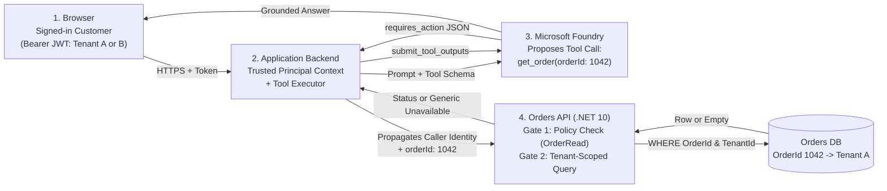
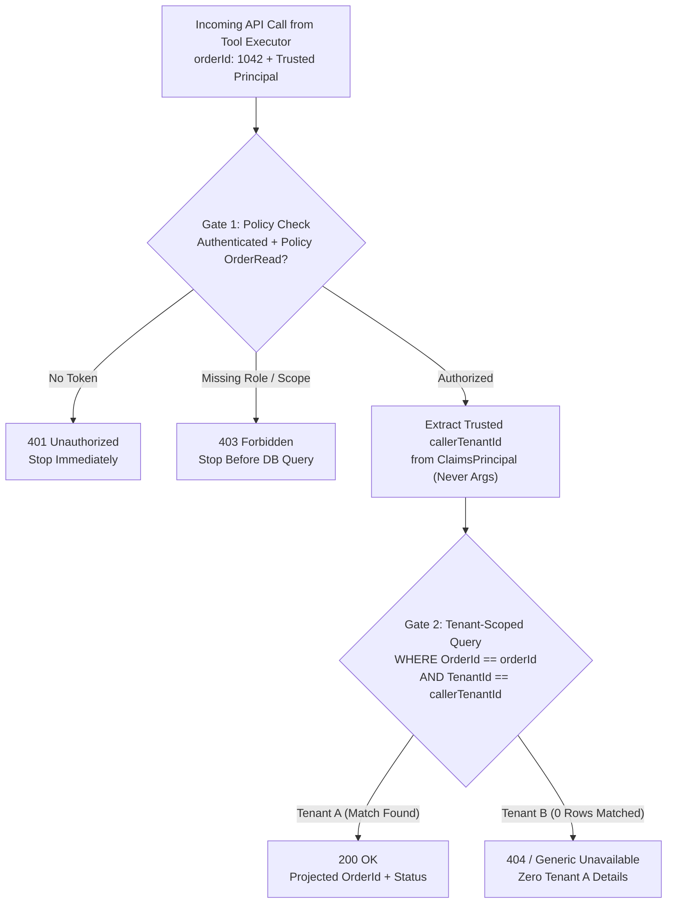

# How Microsoft Foundry Agents Call Tools Safely: Multi-Tenant Authorization, Auth Gates & Tracing in .NET 10

**Author:** Rehan Akbar  
**Role:** Software Engineer  
**Date:** 2026-11-15  
**Reading Time:** 16 min read  
**Series:** Microsoft Foundry: Zero to Production — Episode 01  
**Tags:** `Microsoft Foundry`, `Azure AI Foundry`, `.NET 10`, `ASP.NET Core`, `AI Agents`, `Multi-Tenant Security`, `OpenTelemetry`, `System Design`

---

> **Verification & Scope Note:** The scenario (`OrderId = 1042`, `Tenant A`, `Tenant B`) and telemetry trace layout in this walkthrough match Episode 01's whiteboard model. All core C# / `.NET 10` patterns shown below (`TryParseOrderId` with `JsonUnmappedMemberHandling.Disallow`, `"OrderRead"` policy, `[Authorize(Policy = "OrderRead")]` `/orders/{orderId:int}` endpoint with `AsNoTracking().SingleOrDefaultAsync()`, `OrderAccessAuthorizationHandler`, EF Core `HasQueryFilter` fail-closed sentinel, and the 4-caller access matrix) compiled cleanly and passed `15/15` automated assertions on **ASP.NET Core `.NET 10` (SDK `10.0.404`, runtime `10.0.15`) + `Microsoft.EntityFrameworkCore.Sqlite` `10.0.15`** using a test authentication handler and real SQLite SQL execution. Live Microsoft Foundry cloud execution remains Episode 02's scope; always run your CI tests against your production identity provider and database engine.

When engineering teams connect a Large Language Model (LLM) to real enterprise APIs for the first time, the easiest path looks harmless: register a custom function tool such as `get_order(orderId)`, deploy an agent in **Microsoft Foundry** (formerly Azure AI Foundry), and return whatever the backend database gives back.

Five minutes into manual testing, the demo works. A customer types `"Where's my order 1042?"`, the Foundry model proposes calling `get_order` with `{ "orderId": 1042 }`, your application queries the database, and the assistant replies `"Your order has shipped."`

Then you run the second test case: a different signed-in user from **Tenant B** types `"Where's my order 1042?"`—the exact same order identifier owned by **Tenant A**.

If your Orders API only filters by `OrderId`, the lookup succeeds, returns Tenant A's shipment status back to the Foundry run, and the assistant faithfully leaks another tenant's order information to Tenant B.

Nothing was "hacked" in the network layer. TLS worked. JWT validation passed. The LLM followed its tool definition properly. **The vulnerability happened because authorization was missing between the model's proposed tool arguments and the backend resource query.**

In this walkthrough—matching **Episode 01** of the *Microsoft Foundry: Zero to Production* series—we dissect the complete four-hop request path, trust boundaries, two-gate authorization model in **ASP.NET Core / .NET 10**, distributed tracing layout, failure modes, and the four-caller verification matrix required before trusting an AI agent with live application data.

---

## 1. The Running Scenario & The Core Trust Boundary

Consider a multi-tenant B2B commerce backend serving multiple independent organizations (`Tenant A`, `Tenant B`, and so on) from a shared relational database. Every authenticated user carries a verified `tenant_id` claim and permission scopes issued by your identity provider.

Here is the concrete requirement:

- A signed-in user asks natural-language questions about shipment status: *"Where's my order?"*
- A language model holds conversational context, **not live shipment state**.
- Live shipment state lives inside your **Orders Database**, fronted by an internal or service-to-service **Orders API**.
- In Microsoft Foundry Agent Service, custom function tools follow a **client-side (application-hosted) execution loop**:
  1. Your application forwards the prompt and tool schemas to Microsoft Foundry.
  2. When the model determines it lacks live state, the Foundry run pauses in a `requires_action` state and emits a **proposed tool call** (`name` + JSON `arguments`).
  3. **Your application backend—not the LLM—executes that tool against downstream services** and submits the serialized tool output back to Foundry so the model can synthesize its final reply.

That execution split creates the single most important security boundary in agent engineering:

| Component | Holds Live Data? | Trusted Source of Identity? | Security Responsibility |
|---|---|---|---|
| **Browser / Client** | No | No (sends bearer token) | Authenticated user session transport |
| **Application Backend (Tool Executor)** | Routes requests | **Yes** (verifies JWT / session principal) | Validates tool argument shape, propagates verified caller context |
| **Microsoft Foundry Agent** | No | **No** (reasons over untrusted prompt text) | Intent detection, argument extraction (`get_order`), natural language response |
| **Orders API + Database** | **Yes** | **Yes** (re-validates principal & policy) | Policy gate (`OrderRead`) + tenant-scoped resource query |



Notice the rule enforced across Steps 2 through 4:

> **The order ID (`orderId: 1042`) comes from the model's tool arguments. The tenant identity must always come from the authenticated caller.**

Never place `tenantId` inside the LLM's tool schema and ask the model to fill it in from system prompt instructions. A prompt injection inside a chat turn, email body, or uploaded document can override instructions and make the model propose `"tenantId": "tenant-a"` while logged in as `tenant-b`. Keep `tenantId` completely absent from tool parameters so the model cannot even attempt to spoof it.

---

## 2. How Tool Calling Works in Microsoft Foundry

To expose `get_order` to a Foundry agent, you register a tool declaration containing three parts: a stable **function name**, a clear **description** telling the model when to invoke it, and a strict **JSON parameter schema**.

### Tool Contract (`get_order`)

```json
{
  "type": "function",
  "function": {
    "name": "get_order",
    "description": "Get shipment status for an order",
    "parameters": {
      "type": "object",
      "properties": {
        "orderId": {
          "type": "integer",
          "description": "Numeric order identifier supplied by the user, for example 1042.",
          "minimum": 1
        }
      },
      "required": ["orderId"],
      "additionalProperties": false
    }
  }
}
```

Notice two defensive constraints already built into this contract:

1. **`additionalProperties: false`:** Prevents undocumented fields from sneaking into downstream deserializers.
2. **No caller context fields:** There is no `userId`, `tenantId`, or `isAdmin` property anywhere in the JSON schema.

When the customer asks *"Where's my order 1042?"*, Foundry does not execute SQL or touch your network. Instead, it pauses execution and returns a `requires_action` payload requesting tool execution:

```json
{
  "call_id": "call_01JFX9K2P8...",
  "type": "function_call",
  "name": "get_order",
  "arguments": "{\"orderId\": 1042}"
}
```

### Validating Arguments in the Tool Executor

Even when a JSON schema is attached to a model declaration, your application backend **must re-validate arguments before touching any API**. Models occasionally emit malformed JSON, pass negative or zero IDs, wrap types unexpectedly, or relay adversarial strings injected into conversation history.

A lightweight illustrative validation step inside the `.NET 10` tool executor looks like this:

```csharp
// Tool executor validation pattern (compiled and verified on .NET 10.0.15)
using System.Text.Json;
using System.Text.Json.Serialization;

[JsonUnmappedMemberHandling(JsonUnmappedMemberHandling.Disallow)]
public sealed record GetOrderArguments(
    [property: JsonPropertyName("orderId")] int OrderId);

public static bool TryParseOrderId(string rawArgumentsJson, out int orderId)
{
    orderId = 0;

    GetOrderArguments? parsed;
    try
    {
        parsed = JsonSerializer.Deserialize<GetOrderArguments>(rawArgumentsJson);
    }
    catch (JsonException)
    {
        return false;
    }

    if (parsed is null || parsed.OrderId <= 0)
        return false;

    orderId = parsed.OrderId;
    return true;
}
```

*(Production note: If your domain uses alphanumeric order references such as `"ORD-1042"`, define `"orderId"` as `"type": "string"` with `"maxLength"` and validate it server-side with a C# `[GeneratedRegex]` pattern before forwarding.)*

Once `TryParseOrderId` succeeds, the tool executor forwards two separate inputs to the Orders API:

1. **Data Identifier (`orderId = 1042`)** — untrusted selector extracted from model arguments.
2. **Caller Principal (`ClaimsPrincipal` / verified token context)** — trusted security context held by your backend runtime.

---

## 3. The Broken Baseline: Why ID-Only Lookups Fail Quietly

Before implementing authorization gates, look at what happens in the vulnerable single-gate baseline shown in Scene 12 of the video:

```sql
-- BROKEN: Matches only on the model-supplied identifier
SELECT order_id, status
FROM orders
WHERE order_id = @order_id;
```

Or in an ASP.NET Core minimal API:

```csharp
// VULNERABLE PATTERN — DO NOT SHIP
app.MapGet("/orders/{orderId:int}", async (int orderId, OrdersDbContext db) =>
{
    var order = await db.Orders
        .AsNoTracking()
        .SingleOrDefaultAsync(o => o.OrderId == orderId);

    return order is null ? Results.NotFound() : Results.Ok(new { order.OrderId, order.Status });
})
.RequireAuthorization(); // Only checks "are you signed in?", NOT "can you read Order 1042?"
```

Why is `.RequireAuthorization()` alone dangerously insufficient here?

- `.RequireAuthorization()` only proves **authentication** (Tenant B presented a valid token signed by your IdP).
- Passing `orderId = 1042` succeeds because `1042` is a valid integer primary key that exists in the `Orders` table.
- Because the endpoint never checked whether the caller holds the `OrderRead` permission or whether row `1042` belongs to Tenant B, **HTTP 200 returns Tenant A's shipment status directly into the LLM's context window.**

This class of flaw maps directly to **Broken Object Level Authorization (API1:2023 — BOLA)** in the OWASP API Security Top 10 (2023), and AI agents amplify its exposure because callers can simply ask the model in natural language to check neighboring IDs (*"Check orders 1040 through 1050"*).

---

## 4. The Two-Gate Authorization Model (ASP.NET Core / .NET 10)

Securing agent tool calls requires moving **every data access decision inside your API / data layer** using **two distinct authorization gates**:

1. **Gate 1 — Functional / Policy Gate:** *Can this caller read orders at all?*
2. **Gate 2 — Resource & Tenant Isolation Gate:** *Does this specific order (`1042`) belong to the authenticated caller's tenant?*



Let's examine each layer cleanly using idiomatic **ASP.NET Core (.NET 10)** patterns.

### Gate 1: Enforcing Coarse-Grained Policy (`OrderRead`) Before Any Lookup

Even if a user is authenticated, they might be an unprivileged service caller, a billing-only user, or an anonymous session with a guest token. Gate 1 rejects unauthorized roles before your application even constructs a database query.

In `Program.cs`:

```csharp
// ASP.NET Core (.NET 10) policy setup (compiled and verified on .NET 10.0.15)
builder.Services.AddAuthorization(options =>
{
    options.AddPolicy("OrderRead", policy =>
    {
        policy.RequireAuthenticatedUser();
        policy.RequireAssertion(context =>
            context.User.HasClaim("scope", "orders.read") ||
            context.User.IsInRole("OrderViewer") ||
            context.User.IsInRole("Admin"));
    });
});
```

Two practical rules for Gate 1:

- **Fail closed on missing tenant claims:** Require the `tenant_id` claim inside a dedicated claim policy or endpoint filter so no caller lacking an explicit tenant binding can fall through with `callerTenantId == null` or `""`.
- **Never treat the AI agent service account as a super-tenant bypass:** If your app uses On-Behalf-Of (OBO) user identity delegation or passes the signed-in caller principal into the tool execution pipeline, **evaluate permissions for the human caller**, not a broad service principal.

### Gate 2: Resource-Based Authorization & Tenant-Scoped Queries

Once Gate 1 passes, Gate 2 ensures the caller can only observe rows within their own tenant boundary. In production `.NET 10` backends, engineers apply two complementary patterns:

#### Pattern A: Database-Level Tenant-Scoped Predicate (Primary Enforcement)

Push `callerTenantId` **all the way into the SQL query**, matching both `OrderId` and `TenantId` while projecting only the fields the agent actually needs to answer *"Where's my order?"*:

```csharp
// Illustrative ASP.NET Core (.NET 10) endpoint enforcing OrderRead + Tenant-Scoped Query
using System.Security.Claims;
using Microsoft.AspNetCore.Authorization;
using Microsoft.EntityFrameworkCore;

public sealed record OrderStatusResponse(int OrderId, string Status);

app.MapGet("/orders/{orderId:int}", [Authorize(Policy = "OrderRead")] async (
    int orderId,
    ClaimsPrincipal user,
    OrdersDbContext db,
    CancellationToken ct) =>
{
    var callerTenantId = user.FindFirstValue("tenant_id");
    if (string.IsNullOrWhiteSpace(callerTenantId))
        return Results.Forbid();

    // Gate 2: Match BOTH model-supplied orderId AND verified callerTenantId
    var order = await db.Orders
        .AsNoTracking()
        .Where(o => o.OrderId == orderId
                 && o.TenantId == callerTenantId)
        .Select(o => new OrderStatusResponse(o.OrderId, o.Status))
        .SingleOrDefaultAsync(ct);

    if (order is null)
        return Results.NotFound(new { code = "order_unavailable" });

    return Results.Ok(order);
});
```

*(Note: On ASP.NET Core Minimal APIs, `[Authorize(Policy = "OrderRead")]` on the delegate and `.RequireAuthorization("OrderRead")` on the endpoint builder both attach `OrderRead` authorization metadata; keep whichever convention matches your codebase consistently.)*

Why combine the tenant predicate directly inside the `WHERE` clause rather than loading the row by `orderId` first and checking `if (order.TenantId != callerTenantId)` afterward in C#?

1. **Zero accidental memory exposure:** Tenant A's entity never enters your process heap, serializer, exception dump, or logger when Tenant B asks for `Order 1042`.
2. **Oracle prevention (`404` vs `403` leakage):** If `Order 1042` belongs to Tenant A and your API returns `403 Forbidden` to Tenant B while returning `404 Not Found` for nonexistent order `9999`, you accidentally confirm that `Order 1042` exists! Returning the same generic `NotFound` (`order_unavailable`) whenever a row does not exist inside `callerTenantId` **eliminates cross-tenant existence probing**.
3. **Minimal projection reduces prompt data surface:** Selecting only `OrderId` and `Status` prevents unrelated columns (billing notes, internal flags, customer phone numbers) from entering the model prompt context.

#### Pattern B: Imperative Resource Authorization (`IAuthorizationService`) for Fine-Grained Rules

Microsoft Learn's [ASP.NET Core resource-based authorization guidance](https://learn.microsoft.com/en-us/aspnet/core/security/authorization/resourcebased) uses `IAuthorizationService` when authorization depends on properties of an already-loaded resource—such as checking whether a specific support agent is assigned to that account, or whether the user within Tenant A is the customer who placed that specific order.

```csharp
// Illustrative ASP.NET Core Resource-Based Authorization Requirement & Handler
using System.Security.Claims;
using Microsoft.AspNetCore.Authorization;

public sealed record OrderRecord(
    int OrderId,
    string TenantId,
    string CustomerUserId,
    string Status);

public sealed class SameTenantOrOwnerRequirement : IAuthorizationRequirement { }

public sealed class OrderAccessAuthorizationHandler
    : AuthorizationHandler<SameTenantOrOwnerRequirement, OrderRecord>
{
    protected override Task HandleRequirementAsync(
        AuthorizationHandlerContext context,
        SameTenantOrOwnerRequirement requirement,
        OrderRecord resource)
    {
        var callerTenant = context.User.FindFirstValue("tenant_id");
        var callerUserId = context.User.FindFirstValue(ClaimTypes.NameIdentifier);

        if (string.IsNullOrWhiteSpace(callerTenant) || callerTenant != resource.TenantId)
            return Task.CompletedTask;

        // Within the same tenant: allow either TenantAdmin role or the owning customer
        if (context.User.IsInRole("TenantAdmin") || callerUserId == resource.CustomerUserId)
        {
            context.Succeed(requirement);
        }

        return Task.CompletedTask;
    }
}
```

When using `IAuthorizationService` on top of a tenant-scoped database query:
- **SQL `WHERE TenantId == @callerTenant`** acts as a mandatory hard boundary across tenants.
- **`AuthorizationHandler`** enforces finer rules within a tenant (for example, Customer X cannot view Customer Y's order inside the same company unless Customer X is a `TenantAdmin`).
- If `authResult.Succeeded` is false, convert the response to the same generic unavailable outcome (`Results.NotFound`) when shielding record existence, or `Results.Forbid()` strictly when existence is non-sensitive within the caller's own workspace.

#### Pattern C: EF Core Global Query Filters as a Safety Net

In multi-tenant `.NET 10` codebases, a developer writing a brand-new LINQ query might occasionally forget `&& o.TenantId == callerTenantId`. You can configure an **EF Core Global Query Filter** bound to a scoped `ITenantContext` resolved from `HttpContext.User`:

```csharp
// Illustrative EF Core tenant guard (complementing, not replacing, explicit predicates)
modelBuilder.Entity<OrderEntity>()
    .HasQueryFilter(o => o.TenantId == _tenantContext.VerifiedTenantId);
```

Important caveat: ensure `_tenantContext.VerifiedTenantId` throws or evaluates to an impossible sentinel value (never `null` matching `o.TenantId == null`!) if unauthenticated background code invokes `OrdersDbContext` without an active tenant scope. Relying on a `null` check bug is a classic multi-tenant outage vector; **fail-closed sentinels guarantee zero leaked rows**.

---

## 5. Side-by-Side Comparison: Identical Tool Call, Different Caller

Look at what happens when two users trigger the exact same LLM decision in Microsoft Foundry:

| Step | Run 1: Owner (`Tenant A`) | Run 2: Different Caller (`Tenant B`) |
|---|---|---|
| **User Prompt** | *"Where's my order 1042?"* | *"Where's my order 1042?"* |
| **Foundry Proposed Tool Call** | `get_order(orderId: 1042)` | `get_order(orderId: 1042)` |
| **Trusted Backend Caller Identity** | `sub=u_101`, `tenant_id=tenant-a`, `Policy=OrderRead` | `sub=u_209`, `tenant_id=tenant-b`, `Policy=OrderRead` |
| **Gate 1 (`OrderRead` Policy)** | Pass | Pass |
| **Gate 2 LINQ / SQL Predicate** | `o.OrderId == 1042 && o.TenantId == "tenant-a"` | `o.OrderId == 1042 && o.TenantId == "tenant-b"` |
| **Orders API Outcome** | `200 OK` (`{"orderId":1042,"status":"Shipped"}`) | `404 Not Found` (`{"code":"order_unavailable"}`) |
| **Tool Output Returned to Foundry** | `{"found":true,"status":"Shipped"}` | `{"found":false,"message":"Order unavailable"}` |
| **Assistant Response to Customer** | *"Your order 1042 has shipped."* | *"Order status is unavailable under your account."* |

Notice what changed between Run 1 and Run 2: **not a single word of the prompt, not a single parameter in the Foundry model's tool call, and not a single line of tool definition**. **Caller identity alone changed the outcome.**

And notice what the tool executor sends back to Foundry when Tenant B hits `404`: a **clean, structured, generic unavailable payload**, never raw SQL errors, stack traces, or `"Access denied for Tenant A resource"`. Returning generic non-leaking tool messages enables the Foundry model to respond politely while preserving zero knowledge that Order 1042 exists in another tenant.

---

## 6. Failure Modes, Edge Cases & Recovery

A production AI backend must remain safe under partial failures, malformed model outputs, and credential edge cases. Below are the five primary failure windows in this pipeline and how to handle each safely:

| Failure Mode | How It Happens | Incorrect Behavior | Safe Production Behavior |
|---|---|---|---|
| **1. Model Argument Hallucination / Invalid ID** | Prompt injects non-numeric text or passes `{"orderId": -1}` / `{"orderId": null}` | Unchecked pass-through or uncaught 500 | Deserialization + `orderId > 0` check rejects payload in tool executor; return clean validation message so the model asks for a valid numeric ID |
| **2. Missing / Stale `tenant_id` Claim** | Token comes from a legacy login flow without `tenant_id` | Query runs with `TenantId == null` or falls back to default tenant | Reject immediately at Gate 1 (`Forbid`) before any DB query; fail closed |
| **3. Tool Endpoint Exists Without Resource Check** | API applies `[Authorize]` globally but skips tenant filtering on one route | Returns cross-tenant row whenever any logged-in user guesses an ID | Mandatory scoped `WHERE` predicate + EF Global Query Filter + automated 4-caller integration test suite |
| **4. 403 vs 404 Information Oracle** | API returns `403 Forbidden` if another tenant owns ID `1042` and `404` if ID doesn't exist | Attacker enumerates valid competitor order IDs via tool error phrasing | Collapse both "not found" and "cross-tenant mismatch" into identical `order_unavailable` status |
| **5. Downstream API Timeout During `requires_action`** | Orders DB stalls under load | Foundry run hangs until entire chat turn fails | Enforce `CancellationToken` timeout calibrated to your SLA, log span error, submit safe unavailable JSON tool output cleanly |

---

## 7. End-to-End Observability & Distributed Tracing

When an agent returns the wrong answer—or refuses an authorized user—chat logs alone won't tell you whether the LLM skipped the tool, the tool executor dropped headers, Gate 1 rejected a claim, or Gate 2 filtered out the row.

Microsoft Foundry integrates with **OpenTelemetry (OTel)** and **Azure Monitor Application Insights** so you can connect the agent run and backend authorization spans in one distributed waterfall (illustrative trace layout matching Scene 24 of Episode 01, with no fabricated timings):

```text
TRACE  order-lookup-run-02
├─ agent.run           tool=get_order
├─ tool.execute        orderId=1042
└─ api.orders.get      policy=OrderRead -> OK
   └─ resource.scope   tenant=B -> NoMatch
```

### What to Record — And What Never to Log

Look carefully at the **`api.orders.get`** and **`resource.scope`** child spans—these are the exact spans emphasized in Scene 24 of Episode 01 for debugging authorization decisions:

- **Record structured security outcome tags:** `policy=OrderRead -> OK` (or denied), `auth.tenant_scope_applied = true`, and `resource.scope` (`Match` vs `NoMatch` for `tenant=B`).
- **Propagate W3C `traceparent` headers:** Always forward `Activity.Current` (`traceparent` / `tracestate`) from your tool executor's `HttpClient` into the Orders API so `tool.execute` and `api.orders.get` share the same `Trace ID` as the Foundry agent run.
- **Scrub PII & bearer tokens from spans:** Never attach raw JWTs, customer addresses, full prompt text with PII, or raw SQL parameter values containing sensitive customer details onto span attributes when centralized log teams lack strict content-access permissions (such as Azure Monitor's enhanced log data access roles). Log opaque surrogate keys plus policy/resource outcome enums.

---

## 8. Scaling, Indexing & Defense-in-Depth Trade-Offs

Adding multi-tenant predicates across every tool-backed endpoint also impacts database performance and architecture cleanly if designed up front:

1. **Composite Indexing (`(TenantId, OrderId)` vs `(OrderId)`):**
   Every tenant-scoped lookup runs `WHERE TenantId = @tenantId AND OrderId = @orderId`. Define a composite unique or primary B-tree index starting with `TenantId` (or covering index on `(TenantId, OrderId)` `INCLUDE (Status)`). That enables `O(log N)` B-tree index seeks within the tenant key prefix instead of scanning unrelated rows (actual query latency depends on dataset size, buffer cache residency, and hardware).
2. **Row-Level Security (RLS) vs Application Predicates:**
   PostgreSQL Row-Level Security or SQL Server RLS enforces `current_setting('app.tenant_id')` inside the database engine itself—a strong second line of defense alongside ASP.NET Core predicates. Trade-off: RLS adds session-variable plumbing (`SET LOCAL` on every pooled DB connection) and can complicate cross-tenant operational reporting tools unless dedicated admin roles are isolated carefully. Starting with explicit `.Where(o => o.OrderId == orderId && o.TenantId == callerTenantId)` + EF Query Filters + composite indexes provides primary query-path protection with straightforward unit and integration testability; add database RLS when compliance demands engine-enforced isolation as well.
3. **Stateless Token Propagation vs Service-Account Proxy:**
   Wherever possible, pass the caller's scoped identity context (or short-lived user-bound OBO token) cleanly from Backend → Orders API rather than giving the tool executor a static database connection string with zero per-caller metadata. If an asynchronous worker executes tool runs later without an active browser request, persist the verified `callerTenantId` and caller scopes snapshot at job submission time inside signed metadata—never re-trust free-form prompt text.

---

## 9. Guarantees, Non-Guarantees & Code Review Checklist

Before approving any PR that adds a tool to a Microsoft Foundry agent, run both a design review and an automated test matrix.

### Explicit Guarantees & Limitations of This Architecture

- **What this pattern guarantees (when properly implemented and tested):** Cross-tenant row disclosure is blocked at the API query layer (`Orders API`) regardless of what `orderId` the customer prompts or the Foundry model emits; missing policies or missing tenant claims fail closed before executing data queries.
- **What this pattern does NOT guarantee alone:** Prompt injection cannot steal Tenant A's data through `get_order` if properly scoped, *but* prompt injection can still manipulate how the model summarizes Tenant B's own returned data or tricks Tenant B into triggering side-effecting write tools (`cancel_order`, `refund_order`) unless separate confirmation/authorization controls protect write actions.
- **Verified scope vs Episode 02 scope:** All code patterns shown in this article (`TryParseOrderId` with `JsonUnmappedMemberHandling.Disallow`, `"OrderRead"` policy, `/orders/{orderId:int}` EF Core `AsNoTracking().SingleOrDefaultAsync()` query, Pattern B `OrderAccessAuthorizationHandler`, Pattern C EF Core `HasQueryFilter` fail-closed sentinel, and the 4-caller matrix `200`/`404`/`401`/`403`) compiled and passed `15/15` automated checks under **ASP.NET Core `.NET 10` (`10.0.15` / SDK `10.0.404`) + `Microsoft.EntityFrameworkCore.Sqlite` `10.0.15`** against a test header authentication handler and real SQLite database queries. Live Microsoft Foundry agent tool-loop orchestration and production PostgreSQL/SQL Server `WebApplicationFactory` integration tests remain scoped to Episode 02 and your CI pipeline.

### The 4-Caller Automated Verification Matrix (Verified on .NET 10 · Built Live in Episode 02)

With the patterns verified under `.NET 10` locally, **Episode 02** wires this into a full standalone ASP.NET Core `.NET 10` project (`dotnet new webapi -n OrderAgentApi`) with real EF Core relational persistence and live 4-caller tests against `const int orderId = 1042;`:

| Test Case | Order ID Argument | Caller Profile | Expected HTTP / API Result | Expected Agent Behavior |
|---|---|---|---|---|
| **Case 1 (1. Owner)** | `1042` (`int`) | Signed in · `Tenant A` · `OrderRead` | `200 OK` · `Status` (`Shipped`) | Answers *"Your order 1042 has shipped."* |
| **Case 2 (2. Other Tenant)** | `1042` (`int`) | Signed in · `Tenant B` · `OrderRead` | `404` (`order_unavailable` · No order details) | States order status is unavailable; zero Tenant A data |
| **Case 3 (3. Signed Out)** | `1042` (`int`) | Anonymous / Invalid Token | `401 Unauthorized` | Refuses lookup; prompts sign-in |
| **Case 4 (4. Missing Role)** | `1042` (`int`) | Signed in · `Tenant A` · Missing `OrderRead` | `403 Forbidden` | Refuses access without querying database |

Notice the controlled-variable rule in Case 1 vs Case 2: **hold `const int orderId = 1042;` fixed and vary only the caller identity**. That isolates the authorization logic cleanly so your CI test suite proves caller identity alone drives the decision.

### Pre-Merge Code Review Question & Quick Checklist

Take one crisp question to every AI agent code review:

> **If the Foundry model requests a database record or action, which layer of our backend decides whether the caller can read it—and can a prompt ever override that decision?**

- [ ] Tool JSON schema (`additionalProperties: false`) contains **zero** caller identity or `tenantId` parameters.
- [ ] Tool executor strictly validates and normalizes `orderId` (`int > 0`) before issuing downstream calls.
- [ ] Orders API requires both an explicit **policy gate** (`OrderRead`) and a **fail-closed `tenant_id` claim check**.
- [ ] Database query matches both `(OrderId, TenantId)` inside SQL and projects only the minimal fields (`OrderId`, `Status`) needed by the assistant.
- [ ] Cross-tenant misses return the exact same generic `order_unavailable` response as nonexistent order IDs (zero 403/404 existence oracle).
- [ ] OpenTelemetry spans connect `agent.run` → `tool.execute` → `api.orders.get` → `resource.scope` under a unified `Trace ID` with PII scrubbed.
- [ ] Automated test matrix verifies all 4 callers (`Owner`, `Other Tenant`, `Signed Out`, `Missing Role`) against `const int orderId = 1042;`.

---

## Primary References

1. Microsoft Learn — [Use function calling with Microsoft Foundry agents](https://learn.microsoft.com/en-us/azure/foundry/agents/how-to/tools/function-calling) *(Foundry `requires_action` client-side function tool execution pattern)*
2. Microsoft Learn — [Resource-based authorization in ASP.NET Core](https://learn.microsoft.com/en-us/aspnet/core/security/authorization/resource-based?view=aspnetcore-10.0) *(`IAuthorizationService` imperative authorization handlers for caller + resource checks)*
3. Microsoft Learn — [Introduction to authorization in ASP.NET Core](https://learn.microsoft.com/en-us/aspnet/core/security/authorization/introduction) *(Policy-based and role-based endpoint authorization)*
4. OWASP Foundation — [API1:2023 Broken Object Level Authorization](https://owasp.org/API-Security/editions/2023/en/0xa1-broken-object-level-authorization/) *(OWASP API Security Top 10 2023 object-level authorization failure model)*

---

**Next in Episode 02:** Implementing the full standalone `.NET 10` Web API (`OrderAgentApi`), wiring EF Core persistence with the `OrderRead` policy and tenant-scoped query, and running the 4-caller xUnit integration test suite live.
